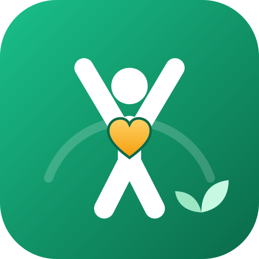

# hlvsuckhoe.com – Trang chủ HLV Sức Khỏe

Trang chủ chia sẻ kiến thức sức khỏe, vi chất, tập thể dục, tập thở, thiền, âm nhạc tự sáng tác và các chủ đề thiên văn, khoa học, lịch sử.

- Trang chủ: **https://hlvsuckhoe.com/** (hướng dẫn dùng trang: `hlvsuckhoe.com/#huong-dan`)
- Ứng dụng HLV Sức Khỏe: **https://app.hlvsuckhoe.com/** (repo `hlv-suc-khoe`)
- Ứng dụng tập thở BreathSync: **https://tho.hlvsuckhoe.com/** (repo `breathsync`)
- Ứng dụng Xưởng kính thiên văn: **https://thienvan.hlvsuckhoe.com/** (repo `xuong-kinh-thien-van`)
- Ứng dụng Tôi & Gia Đình: https://giadinh.hlvsuckhoe.com/ (repo `nddzungx/giadinh`)
- Liên hệ: nddzungx@gmail.com

Trang tĩnh một tệp `index.html`, không cần build. Tệp `CNAME` giữ tên miền – không xóa.
Ảnh: `img/logo.svg` (HLV), `img/logo-thienvan.svg`, `img/logo-breathsync.svg`, `img/logo-giadinh.svg` (logo tạm), `img/qr_ung_ho.png` (VietQR ủng hộ).

## Thư mục
- `counter/worker.js`, `counter/schema.sql` – bộ đếm truy cập (Cloudflare Worker + D1), không chạy trên GitHub, chỉ lưu ở đây để giữ bản gốc.
- `docs/HUONG_DAN.md` – hướng dẫn từng bước: tải lên, EmailOctopus, bộ đếm, Web Analytics, Tôi và Gia đình; tổng kết kinh nghiệm; hướng tiếp theo.

## Cấu hình nhanh (trong `index.html`, tìm bằng Ctrl + F)
- `DÁN MÃ EMAILOCTOPUS` – chỗ dán mã khung đăng ký
- **`js/config.js` → `counterUrl`** – địa chỉ Worker bộ đếm, dùng chung cho trang chủ và mọi bài viết (để trống = ẩn bộ đếm, lượt xem, nút Thích)
- `var FAM_URL` – địa chỉ ứng dụng Tôi & Gia Đình (để trống = quay về "Sắp ra mắt")
- `CLOUDFLARE WEB ANALYTICS` – chỗ dán mã thống kê

## Phiên bản
- **1.5.0** (22/11/2026): bài viết thứ hai **Thở 4–7–8 trước khi ngủ** (`bai-viet/tho-4-7-8-truoc-khi-ngu.html`, có khung thở 4 vòng ngay trong bài); ảnh chia sẻ 1200×630 cho trang chủ và từng bài (`img/og/`, thẻ og:image, twitter card); `sitemap.xml`, `robots.txt` cho Google.
- **1.4.0** (22/11/2026): bài viết đầu tiên **Người gieo "viên thuốc hiểu biết"** (`bai-viet/nguoi-gieo-vien-thuoc-hieu-biet.html`) – chân dung BS. Trần Văn Phúc và cảm hứng ra đời trang; thẻ bài nổi bật trong mục Bài viết, liên kết trong Giới thiệu; thanh **Lượt xem · Thích · Chia sẻ** dùng chung (`js/post-actions.js`, Facebook, X, email, sao chép link, chia sẻ qua Zalo/Messenger trên điện thoại); cài đặt chung `js/config.js`; Worker bộ đếm thêm `/post/view`, `/post/like`, `/post/stats` và bảng `post_marks`.
- **1.3.0** (22/11/2026): ra mắt thẻ **Tôi & Gia Đình** (logo chính thức, mô tả, nút mở `giadinh.hlvsuckhoe.com`); mục mới **Cài lên điện thoại** `#cai-dat` (chọn ứng dụng, hướng dẫn iPhone/Android/máy tính, tự đánh dấu máy đang xem, lưu ý Zalo/Facebook); mỗi thẻ ứng dụng có liên kết "📲 Cài lên điện thoại" tới `…/#cai-dat` của ứng dụng; menu "Cài app"; cập nhật Hướng dẫn và chân trang.
- **1.2.0** (22/11/2026): mục **Nhận tin** (EmailOctopus, xác nhận 2 bước, lời hứa quyền riêng tư); **bộ đếm** Hôm nay · Cộng dồn · Đang xem; mục **Ứng dụng** có tiêu đề + thẻ **Tôi và Gia đình** (sắp ra mắt); **Hướng dẫn sử dụng trang** (nút ?, "Lần đầu ghé thăm", chân trang); menu thêm Ứng dụng, Nhận tin; sửa lỗi thẻ BreathSync dùng nhầm kiểu của khung thở.
- **1.1.1** (22/11/2026): cập nhật mô tả BreathSync 2.1.0 (nguồn số 011, 068, 117, 120, 121, 134, 135; có hướng dẫn sử dụng).
- **1.1.0** (22/11/2026): bỏ dải "bản nháp"; thêm mục **Giới thiệu** (Nguyễn Đức Dũng) và **Mời Dũng một ly cà phê** (VietQR + PayPal, nút chép); ghi chú **đặt bài hát riêng** trong mục Âm nhạc; thêm ứng dụng **BreathSync** (mục Thở & thiền, khối ứng dụng, chân trang, menu).
- **1.0.1**: mục Âm nhạc 20 bài, trình phát youtube-nocookie.

© 2026 Nguyễn Đức Dũng. Bảo lưu mọi quyền.
